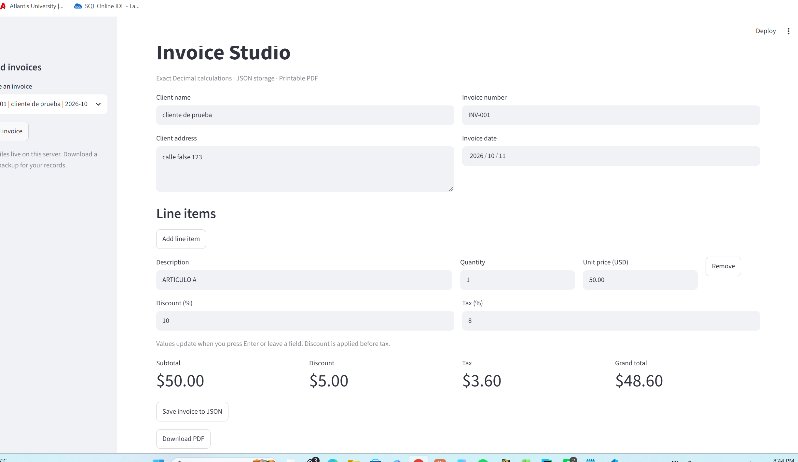

# CIT 105 - Module 4: Invoice Studio

Application 2 of 4: a Streamlit invoicing application with exact Decimal arithmetic, local JSON storage, and printable PDF export.

## Setup

Use Python 3.14 (the local development version). Clone this repository, open a terminal in its root, and run:

```powershell
py -m venv .venv
.\.venv\Scripts\python.exe -m pip install -r requirements.txt
.\.venv\Scripts\python.exe -m streamlit run app.py
```

On macOS/Linux, create the environment with `python3 -m venv .venv` and replace `.\.venv\Scripts\python.exe` with `.venv/bin/python`.

## Use

Enter the client name, address, invoice number, and date. Click **Add line item**, then enter a description, quantity, and unit price. Values recalculate when Enter is pressed or a field loses focus. Remove a line with **Remove**. Text fields are converted directly to Decimal; no float is used for invoice arithmetic.

Set the discount and tax percentages. Click **Save invoice to JSON**, then select a saved invoice in the sidebar and click **Load invoice**. Click **Download PDF** to export the current invoice.

Example: quantity 1 at USD 50.00, discount 10%, tax 8% gives subtotal 50.00, discount 5.00, taxable amount 45.00, tax 3.60, and total **48.60**.

## Module separation

| File | Responsibility |
| --- | --- |
| calculations.py | Decimal arithmetic and validation; no Streamlit imports or calls |
| storage.py | Save, list, and load JSON invoices |
| pdf_export.py | ReportLab PDF layout; calls the calculation module |
| app.py | Streamlit widgets and session state |
| test_calculations.py | Claude baseline plus four student-selected, AI-assisted additional cases |

## Arithmetic decisions

Each line is rounded to cents using ROUND_HALF_UP after multiplying quantity by unit price. Rounded lines are summed. The percentage discount is rounded to cents and subtracted from the subtotal. Tax is calculated on that discounted amount and rounded to cents. The grand total is the discounted amount plus tax.

The discount comes before tax because this assignment taxes the amount payable after the discount. This is the application's calculation rule, not a claim about all jurisdictions.

All calculation inputs must be finite Decimal values. Negative quantities and prices are rejected; zero quantities are allowed. The discount must be between 0 and 100 percent. JSON stores each Decimal as an explicitly tagged string and reconstructs it as Decimal when loaded.

## Testing

```powershell
.\.venv\Scripts\python.exe -m pytest -v
```

**Initial suite:** generated with Claude Code and independently executed with pytest on October 11, 2026. Actual terminal output (excerpt):

```text
platform win32 -- Python 3.14.7, pytest-9.1.1
collecting ... collected 17 items
============================= 17 passed in 0.05s ==============================
```

After adding the four student-selected scenarios below, the actual run of `python -m pytest -q` produced:

```text
.....................                                                    [100%]
21 passed in 0.03s
```

No failing calculation test has been observed in these runs. The four scenarios were selected by the student; Codex helped calculate expected results and wrote the Python tests. They are not presented as independently student-written code.

Manual checks performed with the student: add a line, remove it, and add another; save and reload an invoice; download and open a PDF; confirm the 48.60 example above. Separate development checks confirmed a 97.20 total for quantity 2 and exact Decimal preservation through JSON.

### My four additional test scenarios (AI-assisted implementation)

I selected these four scenarios during the development conversation. I identified zero as the expected result for an invoice with no articles. Codex assisted with the remaining expected amounts and implemented the Python tests. The assignment's independent-work requirement must be assessed with this assistance disclosed.

| Scenario | Expected outcome | What it protects against |
| --- | --- | --- |
| No articles | All totals are 0.00 | Empty-list handling and phantom charges |
| 20% discount on 50.00, 8% tax | Discount 10.00, tax 3.20, total 43.20 | Wrong percentage conversion or taxing the original subtotal |
| Employee discount of 35% on 50.00, 8% tax | Discount 17.50, tax 2.60, total 35.10 | Incorrect handling of a non-round discount rate |
| Early-bird sale of 70% on all articles (two at 25.00), 8% tax | Discount 35.00, tax 1.20, total 16.20 | Applying the promotion to only one article instead of the whole invoice |

## Screenshot and sample PDF

The repository includes `sample_invoice.pdf`, using the 48.60 example. The screenshot below shows the student's running application with that example:



## Deployment

Push this project to a GitHub repository named **cit105-week4**. In Streamlit Community Cloud, create an app from that repository and select **app.py** as the entry point. Select a compatible Python version and install dependencies from requirements.txt.

Saved invoices are local server files. Community Cloud server storage is not guaranteed to survive restarts or redeployment. This assignment version is intended for demonstration with sample data and a single user, not production billing.

Repository: https://github.com/vietahackrios/cit105-week4-

The GitHub repository currently has a trailing hyphen in its name; the assignment requests `cit105-week4`. The student chose to keep the current name.

Deployed application URL: pending publication.

## AI assistance disclosure

OpenAI Codex/ChatGPT assisted with setup, wrote the initial application modules, performed development checks, reviewed and ran the tests, and prepared documentation. The student manually tested the running application and selected four additional scenarios: no articles, a 20% discount, a 35% employee discount, and a 70% early-bird sale. Codex assisted with expected-value calculations and wrote the corresponding Python tests. Claude Code generated the initial calculation suite (17 cases). The combined suite has 21 passing cases. The added tests are AI-assisted, not independently student-written code.
